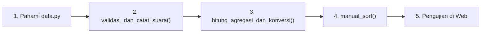
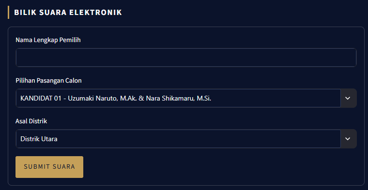
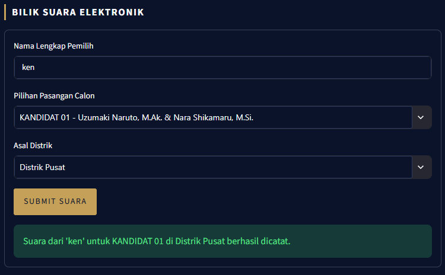
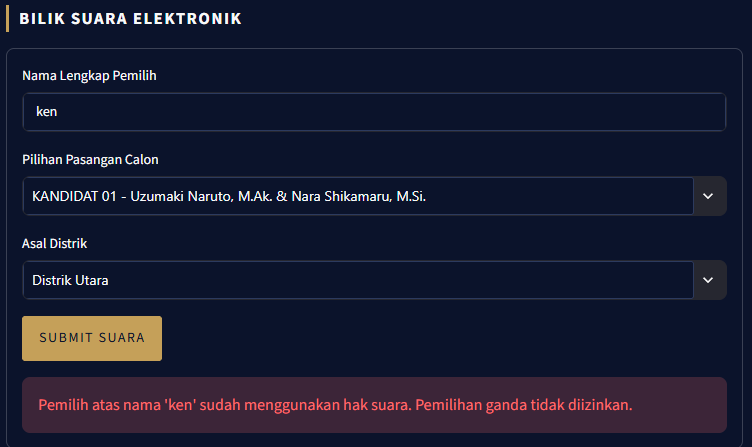
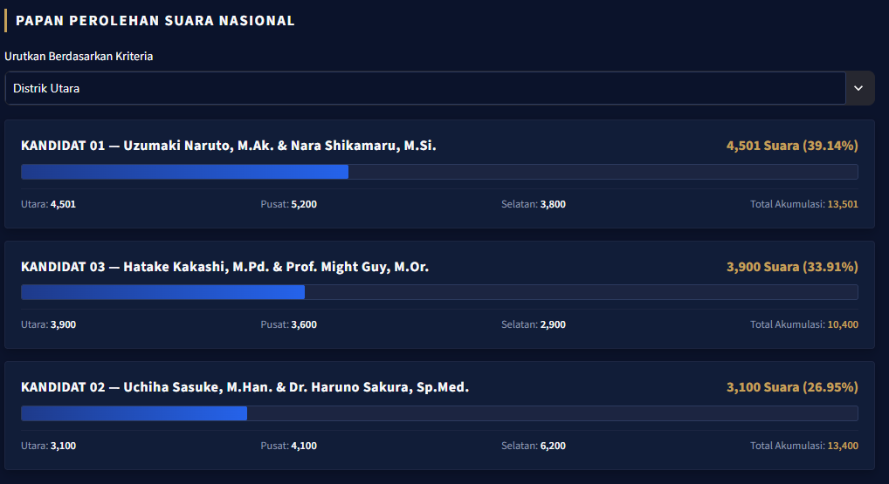

# KONOHA PRESIDENTIAL ELECTION 2024
### Sistem Rekapitulasi Suara & E-Voting Nasional

Repositori ini berisi sistem simulasi e-voting dan rekapitulasi perolehan suara nasional pemilihan Presiden & Wakil Presiden Konoha berbasis Python dan Streamlit. Antarmuka sistem mengusung gaya siaran langsung resmi (*Election Night Live Broadcast*) dengan visualisasi kartu pasangan calon, bilik suara elektronik, dan diagram batang perolehan suara interaktif.

---

## 1. Struktur Berkas & Aturan Pengerjaan

```text
├── data.py                 # Basis data statis (nested dictionary) [READ-ONLY]
├── app.py                  # Antarmuka web Streamlit & sistem penguji visual [READ-ONLY]
├── electionKonoha.py       # BERKAS KERJA UTAMA (Seluruh logika dikerjakan di sini)
├── README.md               # Panduan teknis & spesifikasi pengerjaan
├── gambar/                 # Aset foto resmi kandidat
│   ├── GUY.jpg
│   ├── KAKASHI.jpg
│   ├── NARUTO.jpg
│   ├── SAKURA.jpg
│   ├── SASUKE.jpg
│   └── SHIKAMARU.jpg
└── output_program/         # Referensi tangkapan layar output sistem
    ├── input_vote.png          # Tampilan formulir bilik suara elektronik
    ├── input_vote_sukses.png   # Notifikasi konfirmasi berhasil submit suara
    ├── input_vote_gagal.png    # Notifikasi validasi penolakan double voting
    └── sorting_voters.png      # Papan perolehan suara nasional terurut
```

> **ATURAN PENTING:**  
> Seluruh proses implementasi logika program **HANYA** dilakukan pada berkas `electionKonoha.py`. Jangan memodifikasi struktur data pada `data.py` atau komponen tampilan pada `app.py`.

---

## 2. Instalasi & Menjalankan Aplikasi

Pastikan Python (versi 3.8 ke atas) telah terpasang pada perangkat Anda.

1. **Pasang dependensi yang dibutuhkan:**
   ```bash
   pip install streamlit
   ```

2. **Jalankan aplikasi:**
   ```bash
   streamlit run app.py
   ```
   Aplikasi secara otomatis akan terbuka pada peramban web di alamat `http://localhost:8501`.

---

## 3. Alur & Panduan Pengerjaan Bertahap

Untuk menyelesaikan sistem ini secara sistematis, ikuti alur pengerjaan berikut:



---

### Tahap 1: Memahami Struktur Data Awal (`data.py`)
Buka dan amati struktur data `data_pemilu_konoha` pada `data.py`. Data tersebut merupakan *nested dictionary* dengan format berikut:
- **Kunci Utama (integer):** Nomor urut paslon (`1`, `2`, `3`).
- **Sub-Dictionary `"kandidat"`:** Berisi kunci `"Ketua"` dan `"Wakil"`.
- **Sub-Dictionary `"foto"`:** Lokasi file foto kandidat.
- **Sub-Dictionary `"suara_distrik"`:** Perolehan suara awal per distrik (`"Distrik Utara"`, `"Distrik Pusat"`, `"Distrik Selatan"`).

---

### Tahap 2: Validasi & Pencatatan Suara (`validasi_dan_catat_suara`)
Fungsi ini bertugas memproses hak suara yang dikirimkan melalui bilik suara elektronik.

* **Lokasi Fungsi:** `electionKonoha.py`
* **Definisi Parameter:**
  ```python
  def validasi_dan_catat_suara(nama_pemilih: str, paslon_id: int, distrik: str, pemilu_data: dict, voters_set: set) -> tuple:
  ```

#### Rincian Tugas:
1. **Sanitasi Nama:** Hilangkan spasi kosong di awal dan akhir string `nama_pemilih` menggunakan `.strip()`.
2. **Validasi Nama:** Pastikan nama tidak kosong setelah disanitasi. Jika kosong, batalkan proses dan kembalikan `(False, "Nama pemilih tidak boleh kosong.")`.
3. **Validasi Paslon & Distrik:**
   - Pastikan `paslon_id` terdaftar sebagai kunci pada `pemilu_data`.
   - Pastikan `distrik` terdaftar di dalam `pemilu_data[paslon_id]["suara_distrik"]`.
   - Jika salah satu tidak valid, batalkan proses dan kembalikan status `False` beserta pesan error yang relevan.
4. **Pencegahan Pemilihan Ganda (*Anti Double-Voting*):**
   - Periksa apakah nama pemilih sudah terdaftar di `voters_set`. Pengecekan **wajib mengabaikan perbedaan huruf besar/kecil** (*case-insensitive*, misal: "Naruto" sama dengan "naruto").
   - Jika pemilih sudah terdaftar, batalkan proses dan kembalikan status `False` beserta pesan penolakan.
5. **Pencatatan Suara & Registrasi Pemilih:**
   - Tambahkan 1 poin suara pada distrik yang dipilih: `pemilu_data[paslon_id]["suara_distrik"][distrik] += 1`.
   - Daftarkan nama pemilih ke dalam `voters_set`.
6. **Nilai Kembalian (*Return Value*):**
   - Kembalikan pasangan nilai bertipe tuple: `(True, "Pesan konfirmasi keberhasilan")`.

#### Referensi Tampilan Output Bilik Suara:

<p align="center">
  
  <br>
  <em><b>Gambar 1:</b> Antarmuka bilik suara tempat pemilih memasukkan nama, memilih paslon, dan memilih distrik asal.</em>
</p>

<p align="center">
  
  <br>
  <em><b>Gambar 2:</b> Notifikasi hijau saat suara pemilih berhasil divalidasi dan dicatat oleh sistem.</em>
</p>

<p align="center">
  
  <br>
  <em><b>Gambar 3:</b> Notifikasi merah saat pemilih yang sama mencoba memilih kembali (penolakan double-voting).</em>
</p>

---

### Tahap 3: Agregasi & Konversi Data (`hitung_agregasi_dan_konversi`)
Fungsi ini bertugas mengubah struktur data bersarang (*nested dictionary*) menjadi sekumpulan data terstruktur (*list of dictionaries*) agar dapat ditampilkan oleh komponen visual bar pada papan peringkat.

* **Lokasi Fungsi:** `electionKonoha.py`
* **Definisi Parameter:**
  ```python
  def hitung_agregasi_dan_konversi(pemilu_data: dict) -> list:
  ```

#### Rincian Tugas:
1. **Pengecekan Kasus Khusus:** Jika `pemilu_data` kosong atau `None`, langsung kembalikan list kosong `[]`.
2. **Hitung Suara Nasional:** Hitung akumulasi total suara dari seluruh paslon dan seluruh distrik untuk dijadikan pembagi perhitungan persentase.
3. **Ekstraksi & Transformasi:** Lakukan perulangan untuk setiap paslon pada `pemilu_data`:
   - Ambil data nama Capres dan Cawapres dari sub-dict `"kandidat"`.
   - Ambil perolehan suara dari masing-masing distrik.
   - Hitung total suara akumulasi khusus paslon tersebut (penjumlahan suara dari ketiga distrik).
   - Hitung persentase perolehan suara paslon:
     $$\text{Persentase} = \left(\frac{\text{Total Suara Paslon}}{\text{Total Suara Nasional}}\right) \times 100$$
     *(Antisipasi kemungkinan pembagian dengan nol jika total suara nasional bernilai 0).*
4. **Kamus Kunci yang Wajib Dipatuhi:**
   Setiap pasangan calon harus dikemas ke dalam satu *dictionary* dengan nama kunci (*case-sensitive*) persis seperti di bawah ini, lalu dimasukkan ke dalam list penampung:
   ```python
   {
       "Nomor Urut": nomor_urut,           # int (1, 2, atau 3)
       "Nama Capres": nama_capres,         # str
       "Nama Cawapres": nama_cawapres,     # str
       "Distrik Utara": suara_utara,       # int
       "Distrik Pusat": suara_pusat,       # int
       "Distrik Selatan": suara_selatan,   # int
       "Total Suara": total_suara,         # int
       "Persentase": persentase            # float
   }
   ```
5. **Nilai Kembalian (*Return Value*):**
   - Kembalikan list yang berisi dictionary kandidat tersebut.

---

### Tahap 4: Algoritma Pengurutan Manual (`manual_sort`)
Fungsi ini bertugas mengurutkan data kandidat berdasarkan kriteria yang dipilih pengguna pada dropdown antarmuka.

* **Lokasi Fungsi:** `electionKonoha.py`
* **Definisi Parameter:**
  ```python
  def manual_sort(data_list: list, target_key: str) -> list:
  ```

#### Rincian Tugas:
1. **Pengecekan Kasus Khusus:** Jika `data_list` kosong atau `None`, kembalikan list kosong `[]`.
2. **Immutability Data:** Lakukan penyalinan data agar pengurutan tidak merusak atau memutasi urutan data asli di luar fungsi.
3. **Implementasi Pengurutan Manual:**
   - Susun algoritma sorting secara manual (misalnya: *Bubble Sort*, *Selection Sort*, atau *Insertion Sort*) menggunakan perulangan bertingkat (*nested loop*).
   - Bandingkan elemen berdasarkan nilai dari kunci `target_key` (nilai `target_key` dapat berupa: `"Total Suara"`, `"Distrik Utara"`, `"Distrik Pusat"`, atau `"Distrik Selatan"`).
   - Urutan wajib secara **DESCENDING** (dari nilai terbesar ke terkecil).
4. **Batasan Mutlak:**
   - **DILARANG KERAS** menggunakan fungsi bawaan `sorted()` atau method list `.sort()`.
5. **Nilai Kembalian (*Return Value*):**
   - Kembalikan list baru yang elemen-elemen dictionary-nya telah terurut rapi.

#### Referensi Tampilan Output Papan Perolehan Suara:

<p align="center">
  
  <br>
  <em><b>Gambar 4:</b> Papan perolehan suara nasional setelah diurutkan secara manual berdasarkan kriteria 'Distrik Utara'. Kandidat 01 menempati posisi teratas dengan 4,501 suara (39.14%), diikuti Kandidat 03 (3,900 suara), dan Kandidat 02 (3,100 suara).</em>
</p>

---

## 4. Panduan Verifikasi & Pengujian Hasil

Setelah melengkapi seluruh fungsi di `electionKonoha.py`, lakukan verifikasi langsung pada browser (`streamlit run app.py`):

1. **Uji Bilik Suara Elektronik:**
   - Masukkan nama pemilih, pilih paslon, dan pilih distrik, lalu klik **SUBMIT SUARA** (lihat *Gambar 1*).
   - Periksa apakah muncul notifikasi hijau sukses (*Gambar 2*) dan angka suara pada kartu kandidat bertambah.
   - Coba submit ulang dengan nama yang sama (misal nama huruf kecil semua) untuk memastikan sistem menolak pemilihan ganda (*Gambar 3*).
2. **Uji Papan Perolehan Suara:**
   - Periksa apakah bar horizontal biru dan persentase suara tampil secara proporsional sesuai data teragregasi.
   - Ubah pilihan pada dropdown **"Urutkan Berdasarkan Kriteria"** (misal ke *Distrik Utara* atau *Distrik Selatan*). Pastikan urutan bar berganti secara dinamis dengan paslon yang memiliki suara tertinggi di kriteria tersebut berada di urutan teratas (lihat *Gambar 4*).
3. **Uji Audit Trail:**
   - Buka menu *accordion* **"AUDIT TRAIL DAFTAR PEMILIH TERDAFTAR"** di bagian bawah halaman untuk memastikan nama pemilih yang telah diverifikasi tercatat dengan benar.
4. **Uji Reset Simulasi:**
   - Klik tombol **"RESET SIMULASI"** untuk mengembalikan seluruh angka suara dan daftar pemilih ke kondisi awal.
